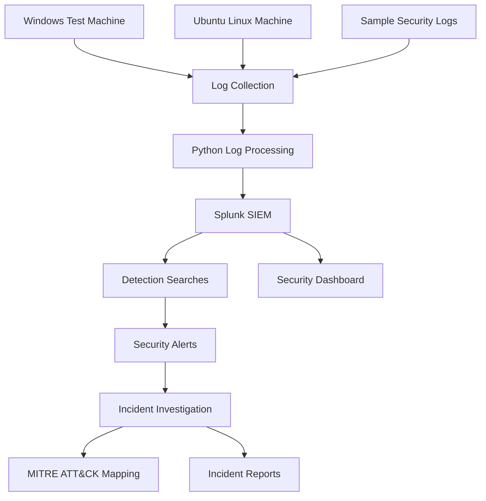

# FITJA — FIRST IT JOB ACADEMY
# CYBERSECURITY PROJECT 01
## SOC THREAT DETECTION & INCIDENT RESPONSE LAB

**Build a Mini Security Operations Centre (SOC) Using Splunk, Python, Linux and Windows Logs**

Target audience: BSc Computer Science / IT students  
Target market: Malaysia cybersecurity internships  
Project level: Beginner to Intermediate  
Suggested duration: 4 weeks  
Portfolio platform: GitHub

---

# 1. PROJECT OVERVIEW

## What is this project?

A Security Operations Centre (SOC) monitors computers, servers, networks and applications to identify suspicious activities and investigate potential cyber incidents.

In this project, students will build a small simulated SOC environment.

They will generate security events, collect logs, analyse suspicious activities, create detection rules, build a dashboard and prepare incident investigation reports.

Students will use tools commonly associated with cybersecurity monitoring and security operations.

## Project problem statement

Organisations generate thousands of system and authentication events every day. Security teams must identify suspicious activity from these events and investigate potential threats before they cause damage.

This project simulates that process in a controlled learning environment.

## Main project objective

Build a mini SOC lab capable of:

1. Collecting sample security logs.
2. Analysing authentication and system events.
3. Identifying suspicious activity.
4. Creating security detection rules.
5. Displaying security events through a Splunk dashboard.
6. Investigating alerts.
7. Preparing incident reports.
8. Recommending security improvements.

## Expected final outcome

At the end of the project, students should have:

- A working lab environment.
- Sample Windows and Linux security logs.
- Python log-analysis scripts.
- Splunk searches and detection rules.
- A security monitoring dashboard.
- Four threat-detection use cases.
- Two incident investigation reports.
- MITRE ATT&CK technique mapping.
- Architecture diagram.
- Complete GitHub repository.
- A short project demonstration video.

---

# 2. SKILLS YOU WILL DEMONSTRATE

| Skill | Practical application |
|---|---|
| Linux | Generate and analyse authentication logs |
| Windows | Understand Windows security events |
| Python | Parse logs and identify suspicious patterns |
| PowerShell | Inspect Windows events |
| Splunk | Search, analyse and visualise logs |
| Networking | Understand source IPs, ports and protocols |
| MITRE ATT&CK | Classify suspicious activities |
| Incident response | Investigate alerts and recommend actions |
| Git and GitHub | Publish technical evidence |
| Documentation | Prepare professional security reports |

## Internship roles this project supports

- SOC Analyst Intern
- Cybersecurity Intern
- Security Operations Intern
- Information Security Intern
- Threat Monitoring Intern
- Cyber Defence Intern
- Junior Security Analyst Intern

---

# 3. SOFTWARE AND TOOLS REQUIRED

Install or access the following tools.

## A. Main tools

| Tool | Purpose | Official link |
|---|---|---|
| Splunk | SIEM and log analysis | https://www.splunk.com/ |
| Ubuntu | Linux lab environment | https://ubuntu.com/download |
| VirtualBox | Run virtual machines | https://www.virtualbox.org/ |
| Python | Log processing and automation | https://www.python.org/downloads/ |
| Visual Studio Code | Code editor | https://code.visualstudio.com/ |
| Git | Version control | https://git-scm.com/ |
| GitHub | Project portfolio | https://github.com/ |
| Sysmon | Windows event collection | https://learn.microsoft.com/en-us/sysinternals/downloads/sysmon |
| draw.io | Architecture diagrams | https://app.diagrams.net/ |
| MITRE ATT&CK | Threat classification | https://attack.mitre.org/ |

## B. Optional tools

| Tool | Purpose | Link |
|---|---|---|
| PowerShell | Windows event inspection | https://learn.microsoft.com/en-us/powershell/ |
| TryHackMe | Practical cybersecurity learning | https://tryhackme.com/ |
| Splunk Training | SIEM learning | https://www.splunk.com/en_us/training.html |
| Wireshark | Network traffic analysis | https://www.wireshark.org/ |

**Important:** Check current Splunk licensing, installation requirements and free-use limits before selecting your installation method.

---

# 4. PROJECT ARCHITECTURE

## How the SOC lab works

The architecture consists of five stages.

1. Log generation.
2. Log collection.
3. Log analysis.
4. Alert generation.
5. Incident investigation and reporting.

## Architecture diagram



## Explanation of each component

**Windows test machine:** Generates authentication and system events.

**Ubuntu Linux:** Provides authentication logs and Linux system events.

**Sample security logs:** Provide safe test data for students who cannot operate two virtual machines.

**Python:** Extracts relevant information from logs and identifies suspicious patterns.

**Splunk:** Searches, analyses and visualises security events.

**Detection searches:** Identify repeated failed logins, unusual account activity and other suspicious behaviour.

**Incident investigation:** Examines the alert, evidence, impact and recommended response.

**Dashboard:** Displays security events and investigation trends.

---

# 5. LAB ENVIRONMENT SETUP

## Step 1 — Prepare your computer

Recommended starting configuration:

- 8 GB RAM minimum; 16 GB preferred.
- 30–50 GB available disk space.
- Windows 10/11 or a compatible host OS.
- Internet connection for downloading tools.
- VirtualBox or another supported virtualisation platform.

Actual requirements depend on the operating system and Splunk installation selected.

## Step 2 — Install Ubuntu

1. Visit https://ubuntu.com/download/desktop
2. Download the Ubuntu ISO.
3. Install VirtualBox.
4. Create a new virtual machine.
5. Attach the Ubuntu ISO.
6. Install Ubuntu.
7. Create a user account.
8. Update the operating system.

Example commands:

```bash
sudo apt update
sudo apt upgrade -y
```

Check the operating system:

```bash
uname -a
```

Check the IP address:

```bash
ip addr
```

## Step 3 — Prepare Linux authentication logs

Linux authentication events are commonly recorded in:

```bash
/var/log/auth.log
```

On some distributions, authentication events may be available through the system journal instead.

View recent authentication activity:

```bash
sudo tail -n 50 /var/log/auth.log
```

Search for failed authentication messages:

```bash
sudo grep -i "failed" /var/log/auth.log
```

Do not assume all Linux distributions use the same log path or message format.

## Step 4 — Prepare Windows logs

Windows Event Viewer provides access to security and system logs.

1. Open Windows.
2. Search for Event Viewer.
3. Open Windows Logs.
4. Select Security.
5. Review authentication events.
6. Record relevant event IDs and descriptions.

Useful Windows security event IDs:

| Event ID | Meaning |
|---|---|
| 4624 | Successful logon |
| 4625 | Failed logon |
| 4634 | Logoff |
| 4648 | Logon using explicit credentials |
| 4720 | User account created |
| 4722 | User account enabled |
| 4728 | Member added to security-enabled global group |

Event IDs must be interpreted with their surrounding context. An event alone does not prove malicious activity.

## Step 5 — Install Sysmon (optional)

Sysmon provides detailed information about selected Windows system activity.

Official documentation:

https://learn.microsoft.com/en-us/sysinternals/downloads/sysmon

Students should:

1. Download Sysmon from Microsoft's official site.
2. Read the installation instructions.
3. Install it on the dedicated test machine.
4. Review the generated Sysmon events.
5. Record the event sources and useful fields.

Do not install monitoring software on another person's device without permission.

## Step 6 — Install Python

Download:

https://www.python.org/downloads/

Verify installation:

```bash
python --version
```

Install the required library:

```bash
pip install pandas
```

## Step 7 — Install Splunk

Visit:

https://www.splunk.com/

Select an appropriate supported Splunk installation for your lab.

Follow the official installation documentation:

https://docs.splunk.com/

Configure a local test environment and use sample logs initially.

The objective is to learn the SIEM workflow before attempting more advanced log forwarding.

---

# 6. FOUR PRACTICAL THREAT-DETECTION USE CASES

Students must implement all four use cases.

## USE CASE 1 — Multiple Failed Login Attempts

### Scenario

An account receives many failed login attempts within a short period.

This may indicate:

- Password guessing.
- Brute-force attempts.
- An incorrectly configured application.
- A user repeatedly entering an incorrect password.

### What to detect

Identify:

- Username.
- Source IP address, where available.
- Number of failed attempts.
- Event timestamps.
- Whether a successful login followed the failures.

### Sample Splunk search

Adapt field names to your actual log source and data model.

```spl
index=* ("Failed password" OR "failed logon")
| stats count AS failed_attempts
        earliest(_time) AS first_seen
        latest(_time) AS last_seen
        by user, src_ip
| where failed_attempts >= 5
| convert ctime(first_seen)
| convert ctime(last_seen)
| sort - failed_attempts
```

### Expected result

A table identifying accounts and source IPs associated with repeated failures.

### Student task

Create a screenshot of the search result.

Explain why repeated failed logins may be suspicious and identify alternative explanations.

---

## USE CASE 2 — Successful Login Following Repeated Failures

### Scenario

A user account experiences repeated failed logins followed by a successful login.

This can warrant investigation, but it does not automatically establish that an account was compromised.

### What to investigate

- Username.
- Source IP.
- Failure timestamps.
- Successful login timestamp.
- Whether the source IP changed.
- Whether the login time is unusual for the account.

### Sample Splunk search

```spl
index=* ("Failed password" OR "Accepted password")
| eval event_type=if(
    match(_raw, "Failed password"),
    "Failure",
    "Success"
  )
| stats
    count(eval(event_type="Failure")) AS failures,
    count(eval(event_type="Success")) AS successes,
    earliest(_time) AS first_seen,
    latest(_time) AS last_seen
    by user, src_ip
| where failures >= 3 AND successes >= 1
| convert ctime(first_seen)
| convert ctime(last_seen)
```

### Expected result

A list of accounts with both failed and successful login activity in the selected search period.

### Student task

Explain:

1. What happened?
2. Which account was involved?
3. What evidence is available?
4. What additional evidence is needed?
5. What action should a SOC analyst recommend?

---

## USE CASE 3 — Unusual Account Creation

### Scenario

A new account is created on a Windows test machine.

Account creation may be legitimate or suspicious depending on the user, permissions, time and business reason.

### Windows event

Event ID 4720 — A user account was created.

### Example PowerShell command

Run on your own Windows test machine:

```powershell
Get-WinEvent -FilterHashtable @{
    LogName = 'Security'
    Id = 4720
} -MaxEvents 20 |
Select-Object TimeCreated, Id, ProviderName, Message
```

### Sample Splunk search

```spl
index=* EventCode=4720
| table _time, host, SubjectUserName,
        TargetUserName, EventCode
| sort - _time
```

Field names depend on the Windows event input and parsing configuration.

### Expected result

A list of account creation events.

### Student task

Prepare a report containing:

- Created account.
- Initiating account.
- Host machine.
- Event timestamp.
- Whether the activity was expected.
- Recommended validation steps.

---

## USE CASE 4 — Suspicious PowerShell Activity

### Scenario

PowerShell is used for normal administration, but it can also be abused by attackers.

The objective is to understand how a SOC analyst reviews unusual command execution.

### What to examine

- Process execution time.
- Executing account.
- Parent process.
- Command-line details, if available.
- Whether the activity was authorised.
- Related endpoint and authentication events.

### Example Splunk search

```spl
index=* (EventCode=4688 OR EventID=1)
| search NewProcessName="*powershell.exe"
    OR Image="*powershell.exe"
| table _time, host, user,
        NewProcessName, CommandLine, Image
| sort - _time
```

The fields differ between Windows Security event 4688 and Sysmon event 1. Adjust the search to your actual source.

### Expected result

A list of PowerShell process execution events.

### Student task

Identify one test event and explain whether it is expected administrative behaviour or requires further investigation.

Do not classify a command as malicious solely because it uses PowerShell.

---

# 7. PYTHON LOG ANALYSIS

Students will create a simple Python script that reads sample authentication logs and identifies repeated failed login messages.

Create a file:

```text
failed_login_analyzer.py
```

## Example Python script

```python
import re
from collections import Counter

LOG_FILE = "sample_auth.log"

failed_users = Counter()
failed_ips = Counter()

with open(LOG_FILE, "r", encoding="utf-8", errors="ignore") as file:
    for line in file:

        if "Failed password" not in line:
            continue

        user_match = re.search(
            r"for (?:invalid user )?(\S+)",
            line
        )

        ip_match = re.search(
            r"from (\d+\.\d+\.\d+\.\d+)",
            line
        )

        if user_match:
            failed_users[user_match.group(1)] += 1

        if ip_match:
            failed_ips[ip_match.group(1)] += 1

print("\nFAILED LOGIN COUNTS BY USER")

for user, count in failed_users.most_common():
    print(f"{user}: {count}")

print("\nFAILED LOGIN COUNTS BY IP")

for ip, count in failed_ips.most_common():
    print(f"{ip}: {count}")
```

## Example output

```text
FAILED LOGIN COUNTS BY USER

admin: 8
testuser: 5
student: 2

FAILED LOGIN COUNTS BY IP

192.0.2.10: 8
192.0.2.20: 5
```

These are illustrative values from a simulated log file.

The addresses in this example are documentation-only IP addresses, not evidence of actual attacks.

## Student improvement tasks

After the basic script works:

1. Add timestamp extraction.
2. Add a configurable detection threshold.
3. Export results into CSV.
4. Add a severity label.
5. Create a summary report.
6. Add unit tests.
7. Document limitations.

## Important limitation

This simple script is a learning exercise. It is not a production detection engine. It only understands the specific log format used in its sample data.

---

# 8. BUILD A SPLUNK SECURITY DASHBOARD

Create a dashboard titled:

**FITJA — SOC Threat Monitoring Dashboard**

## Dashboard panels

| Panel | Information displayed |
|---|---|
| Total security events | Total events in the selected period |
| Failed logins | Count of failed authentication events |
| Successful logins | Count of successful authentication events |
| Top source IPs | IP addresses with the most failed logins |
| Account activity | Accounts with repeated authentication failures |
| Account creation | New user account events |
| PowerShell activity | Selected PowerShell process events |
| Event timeline | Security event trends over time |

## Dashboard design reference

```text
+-------------------------------------------------------+
|       FITJA - SOC THREAT MONITORING DASHBOARD         |
+----------------------+--------------------------------+
| Total Events         | Failed Login Attempts          |
|       1,250          |             38                 |
+----------------------+--------------------------------+
| Successful Logins    | New Account Events             |
|         920          |              4                 |
+-------------------------------------------------------+
|               Security Event Timeline                 |
|                                                       |
|              [Time-series chart]                      |
+-------------------------------------------------------+
| Top Source IPs       | Suspicious User Activity       |
|                     |                                 |
| 192.0.2.10          | admin - 8 failures              |
| 192.0.2.20          | testuser - 5 failures           |
+----------------------+--------------------------------+
|             Investigation Queue                      |
+-------------------------------------------------------+
```

The values above are illustrative. Use actual results from your own test environment.

## Dashboard completion checklist

- [ ] Dashboard created.
- [ ] Total event panel added.
- [ ] Failed login panel added.
- [ ] Successful login panel added.
- [ ] Top source IP panel added.
- [ ] Account activity panel added.
- [ ] Timeline visualisation added.
- [ ] Screenshots saved.
- [ ] Each panel explained in README.

---

# 9. MITRE ATT&CK MAPPING

MITRE ATT&CK provides a knowledge base of adversary tactics and techniques.

Official site:

https://attack.mitre.org/

Students should understand the difference between observing an event and proving an attacker technique.

| Project use case | Possible ATT&CK mapping |
|---|---|
| Repeated failed login attempts | T1110 – Brute Force |
| Suspicious account creation | T1136 – Create Account |
| Suspicious PowerShell execution | T1059.001 – PowerShell |
| Successful login after failures | Investigate context before assigning a technique |

For each detection, document:

1. Detection name.
2. Relevant event.
3. Possible ATT&CK technique.
4. Supporting evidence.
5. Detection limitations.
6. Recommended investigation steps.

Reference:

https://attack.mitre.org/techniques/enterprise/

---

# 10. INCIDENT INVESTIGATION REPORT

Students must prepare at least two incident reports.

## Sample incident scenario

**Incident ID:** FITJA-SOC-001  
**Incident name:** Repeated Failed Login Attempts  
**Severity:** Medium — illustrative assessment  
**Environment:** Student SOC Lab  
**Status:** Investigated — simulated event

### 1. Executive summary

Multiple failed authentication attempts were observed against a test account in the simulated environment.

The event was flagged for investigation because repeated authentication failures can indicate password guessing or other suspicious activity.

### 2. Evidence

| Field | Example |
|---|---|
| Username | admin |
| Source IP | 192.0.2.10 |
| Failed attempts | 8 |
| Environment | Ubuntu test VM |
| Log source | Authentication log |
| Event type | Failed authentication |
| Time | Simulated test time |

### 3. Investigation

- Reviewed authentication logs.
- Identified the username.
- Identified the source IP.
- Counted repeated failures.
- Checked for subsequent successful logins.
- Reviewed whether the activity was expected.

### 4. Impact assessment

No successful unauthorised access has been established from the sample evidence.

Further validation would be required to determine whether an account was compromised.

### 5. Recommended response

- Validate the source of the activity.
- Review successful login events.
- Confirm whether the account owner recognises the activity.
- Review password and authentication controls.
- Escalate if evidence supports compromise.

### 6. Lessons learned

The exercise demonstrates how authentication logs can support early detection and investigation.

---

# 11. SECOND INCIDENT REPORT — UNUSUAL ACCOUNT CREATION

**Incident ID:** FITJA-SOC-002  
**Incident name:** Unusual Windows Account Creation  
**Severity:** Medium — illustrative assessment  
**Environment:** Windows Test Machine

### Executive summary

A new user account was created on the test Windows machine.

The activity was reviewed to determine whether the account creation was expected and authorised.

### Evidence to collect

- Windows event ID.
- Account name.
- Initiating account.
- Host machine.
- Timestamp.
- Related privilege changes.

### Investigation questions

1. Was the account creation authorised?
2. Who initiated the activity?
3. Was the account granted elevated permissions?
4. Was the account creation expected?
5. Were any unusual logins recorded afterwards?

### Recommended response

Validate the activity with the system owner, review account permissions and remove or disable unauthorised accounts according to the organisation's approved procedure.

---

# 12. GITHUB REPOSITORY SETUP

Create a public GitHub repository.

Recommended repository name:

```text
SOC-Threat-Detection-and-Incident-Response-Lab
```

## Repository structure

```text
SOC-Threat-Detection-and-Incident-Response-Lab/
│
├── README.md
│
├── architecture/
│   └── soc-architecture.png
│
├── sample-logs/
│   ├── sample_auth.log
│   └── README.md
│
├── python-scripts/
│   └── failed_login_analyzer.py
│
├── splunk-queries/
│   ├── failed-login-detection.spl
│   ├── successful-login-after-failures.spl
│   ├── account-creation-detection.spl
│   └── powershell-activity.spl
│
├── dashboards/
│   └── dashboard-description.md
│
├── incident-reports/
│   ├── incident-001.md
│   └── incident-002.md
│
├── mitre-mapping/
│   └── technique-mapping.md
│
├── screenshots/
│   ├── dashboard.png
│   ├── failed-login.png
│   └── incident-investigation.png
│
└── docs/
    ├── installation.md
    └── lessons-learned.md
```

Never upload passwords, access tokens, private logs, real personal information or sensitive system details.

Use synthetic or sanitised sample data.

---

# 13. COMPLETE GITHUB README TEMPLATE

Copy the following into the repository's README.md.

```markdown
# SOC Threat Detection & Incident Response Lab

## Project Overview

This project demonstrates a simulated Security Operations
Centre (SOC) environment developed for cybersecurity learning.

The lab uses Splunk, Python, Linux and Windows security
events to investigate suspicious activity and document
incident response recommendations.

## Objectives

- Collect and analyse security logs.
- Identify suspicious authentication activity.
- Create SIEM detection searches.
- Build a security monitoring dashboard.
- Investigate security alerts.
- Map relevant activity to MITRE ATT&CK.
- Document findings and recommendations.

## Technologies Used

- Splunk
- Python
- Ubuntu Linux
- Windows Event Logs
- Sysmon (if implemented)
- PowerShell
- Git and GitHub
- MITRE ATT&CK

## Architecture


## Detection Use Cases

1. Multiple Failed Login Attempts
2. Successful Login Following Repeated Failures
3. Unusual Account Creation
4. Suspicious PowerShell Activity

## Python Log Analyzer

The Python script analyses sample Linux authentication
logs and identifies repeated failed login messages.

## Splunk Dashboard

The dashboard provides visibility into:

- Security event counts
- Failed logins
- Successful logins
- Source IP activity
- Account creation events
- Security event trends

## Incident Reports

Two simulated incident investigation reports are included.

## MITRE ATT&CK Mapping

Relevant techniques are documented with evidence
and investigation limitations.

## Key Learning Outcomes

- SIEM fundamentals
- Log analysis
- Security monitoring
- Incident investigation
- Python automation
- Linux and Windows security events

## Disclaimer

This project was developed for educational purposes
in a controlled lab environment.

Testing was performed only on systems owned by
the author or for which explicit permission was obtained.

## Author

Name: [Your Name]

LinkedIn: [Your LinkedIn URL]

GitHub: [Your GitHub URL]
```

---

# 14. CV PROJECT DESCRIPTION

Use this description after completing the project.

## SOC Threat Detection & Incident Response Lab

- Developed a simulated SOC environment using Splunk, Python, Linux and Windows security logs.
- Created detection searches for repeated failed logins, successful logins following failures, account creation and suspicious PowerShell activity.
- Built a SIEM dashboard to visualise security events and authentication trends.
- Developed a Python script to parse authentication logs and identify repeated failed login activity.
- Prepared incident investigation reports and mapped relevant detections to MITRE ATT&CK.

**Technologies:** Splunk, Python, Ubuntu Linux, Windows Event Logs, PowerShell, GitHub, MITRE ATT&CK.

Only include the features and results actually implemented.

---

# 15. LINKEDIN PROJECT DESCRIPTION

Suggested LinkedIn project title:

**Building a Mini SOC Lab | Splunk + Python + Linux**

Suggested description:

I developed a hands-on SOC Threat Detection and Incident Response Lab to strengthen my practical cybersecurity skills.

The project demonstrates how security logs can be collected, analysed and used to identify suspicious activity.

Key activities:
- Splunk SIEM searches and dashboard development.
- Python-based authentication log analysis.
- Linux and Windows event investigation.
- Four security detection use cases.
- Incident investigation and MITRE ATT&CK mapping.

This project helped me understand the workflow of a Security Operations Centre and the importance of evidence-based security investigation.

GitHub: [Insert repository link]

---

# 16. FOUR-WEEK STUDENT EXECUTION PLAN

## Week 1 — Lab Setup and Log Collection

Tasks:

- Install Ubuntu.
- Prepare Windows test environment or sample logs.
- Install Python.
- Install Splunk.
- Understand authentication logs.
- Collect sample security events.

Deliverable:

Working lab and sample logs.

## Week 2 — Python and Splunk Detection

Tasks:

- Write Python log analyser.
- Import logs into Splunk.
- Create failed login searches.
- Create successful-login correlation search.
- Create account creation search.
- Create PowerShell activity search.

Deliverable:

Four detection use cases.

## Week 3 — Dashboard and Investigation

Tasks:

- Create Splunk dashboard.
- Review suspicious events.
- Prepare two incident reports.
- Map relevant activity to MITRE ATT&CK.
- Capture screenshots.

Deliverable:

Dashboard and incident documentation.

## Week 4 — GitHub and Interview Preparation

Tasks:

- Organise repository.
- Write README.
- Add architecture diagram.
- Upload sanitised evidence.
- Record project demonstration.
- Prepare CV and LinkedIn description.
- Practise interview questions.

Deliverable:

Complete public portfolio project.

---

# 17. PROJECT COMPLETION CHECKLIST

## Environment

- [ ] Ubuntu installed.
- [ ] Windows test environment or sample logs ready.
- [ ] Python installed.
- [ ] Splunk configured.
- [ ] Sample logs collected.

## Detection

- [ ] Failed login detection completed.
- [ ] Successful login after failures analysed.
- [ ] Account creation detection completed.
- [ ] PowerShell activity investigation completed.

## Python

- [ ] Python script completed.
- [ ] Script tested with sample logs.
- [ ] Results documented.
- [ ] Limitations explained.

## Splunk

- [ ] Logs indexed.
- [ ] Detection searches saved.
- [ ] Dashboard created.
- [ ] Screenshots captured.

## Incident Response

- [ ] Incident report 1 completed.
- [ ] Incident report 2 completed.
- [ ] Evidence documented.
- [ ] Recommended actions recorded.
- [ ] MITRE mapping reviewed.

## GitHub

- [ ] Public repository created.
- [ ] README completed.
- [ ] Architecture diagram uploaded.
- [ ] Scripts uploaded.
- [ ] Splunk searches uploaded.
- [ ] Screenshots uploaded.
- [ ] No secrets or personal information exposed.

## Career Preparation

- [ ] CV updated.
- [ ] LinkedIn project description added.
- [ ] GitHub profile updated.
- [ ] Project demonstration recorded.
- [ ] Mock interview completed.

---

# 18. CYBERSECURITY INTERVIEW QUESTIONS

Students should be able to answer these questions after finishing the project.

### SOC Fundamentals

1. What is a Security Operations Centre?
2. What is SIEM?
3. What is the difference between an event and an alert?
4. What is log analysis?
5. What is incident response?
6. What is alert triage?

### Splunk

7. What is Splunk used for?
8. What is an index?
9. What is a Splunk search?
10. How did you create your dashboard?
11. How did you detect repeated failed login attempts?

### Networking

12. What is an IP address?
13. What is DNS?
14. What is the difference between TCP and UDP?
15. What is a firewall?
16. What is a brute-force attack?

### Linux and Windows

17. Where can Linux authentication logs be found?
18. What is Windows Event Viewer?
19. What is Sysmon?
20. What is PowerShell?

### Incident Investigation

21. How would you investigate repeated failed login attempts?
22. What would you check after a successful login following repeated failures?
23. How would you investigate unusual account creation?
24. What information should an incident report contain?
25. What is MITRE ATT&CK?

### Project Explanation

26. Explain your SOC architecture.
27. Which tools did you use?
28. What was the most difficult part?
29. What limitations does your detection script have?
30. What would you improve in the next version?

---

# 19. HOW TO PRESENT THIS PROJECT TO A RECRUITER

Prepare a five-minute demonstration.

**Minute 1 — Introduction**

Explain the cybersecurity problem and your project objective.

**Minute 2 — Architecture**

Show your SOC architecture and explain how logs reach Splunk.

**Minute 3 — Detection**

Demonstrate one failed-login detection and show the result.

**Minute 4 — Investigation**

Show your incident report and explain your investigation process.

**Minute 5 — Learning**

Explain the technical skills you developed and what you would improve.

A recruiter should be able to understand what you built, why you built it and how you tested it.

---

# 20. FINAL CAREER ADVICE

This project is designed to help students demonstrate practical skills relevant to cybersecurity internships in Malaysia.

It does not guarantee an internship or replace formal training, certifications or employer-specific requirements.

The strongest portfolio is one where the student can:

- Explain every tool used.
- Demonstrate the project live.
- Explain the detection logic.
- Show genuine screenshots.
- Discuss limitations honestly.
- Explain how they investigated an alert.
- Present a professional GitHub repository.

## FITJA FINAL MESSAGE

**DON'T JUST COLLECT CERTIFICATES. BUILD EVIDENCE.**

Build it. Test it. Document it. Publish it. Explain it.

**FITJA — FIRST IT JOB ACADEMY**

Preparing students for their first IT job through practical skills, career roadmaps and project-based learning.
```

